# Inteligencia Musical: Predicción de Popularidad de Canciones en Spotify

**Asignatura:** MLY1101 – Machine Learning **Evaluación:** Evaluación Parcial N°1 – Presentación y defensa técnica del proyecto **Caso:** C – Inteligencia musical y predicción de popularidad de canciones (Spotify Tracks) **Integrantes del grupo:** \[Matías Cornejo, José Filidey, Gerald Santana\] **Fecha:** \[14/09/2026\]

## 1. Descripción del problema de negocio

La plataforma de Spotify necesita anticipar qué canciones tienen mayor probabilidad de ser populares para optimizar decisiones de inversión en marketing y promoción de artistas. Por lo que requieren un análisis exploratorio de los datos, evaluación de sesgos y una serie de conclusiones preliminares para empezar a tomar decisiones sobre su catálogo.

### 1.1 Planteamiento del problema

¿Es posible predecir el nivel de popularidad de una canción a partir de sus características de audio (danceability, energy, tempo, etc.) y metadatos (género, duración, explicit)?

Esta pregunta resume principalmente el objetivo general de los requerimientos del cliente. Puesto que a un nivel general predecir qué canciones priorizar o en que artistas invertir reduce el riesgo de pérdidas y aumenta la probabilidad de ganancias futuras.

## 2. Objetivos del proyecto

### 2.1 Objetivo general

Desarrollar un modelo de Machine Learning capaz de predecir la popularidad de una canción en Spotify a partir de sus atributos de audio y metadatos.

### 2.2 Objetivos específicos

Realizar un análisis exploratorio de datos (EDA) para identificar patrones y relaciones entre las variables de audio y la popularidad.

Evaluar la calidad de los datos e implementar un proceso de limpieza y preparación adecuado.

Identificar las variables más relevantes para la predicción de popularidad.

Evaluar posibles sesgos y consideraciones éticas asociadas al uso de estos datos.

### 2.3 KPIs del proyecto

Uno de los objetivos del proyecto es la creacion de KPIs y sus metas.

 | KPIs | Definicion | Meta |
 |--|--|--|
 | Precision en el top | Sera un porcentaje de canciones las cuales el modelo marcara como el "top 10% del genero", y realmente lo son. | ≥ 40% |
 | Equidad entre generos | La diferencia de error entre el genero mejor y el peor predicho | ≤ 10 puntos |
 | Tasa de falsos positivos | Sera el porcentaje de canciones que el modelo predice como populares, pero en verdad resultan no serlo (popularidad < 40) | ≤ 15% |
 | Error de prediccion (MAE) | Diferencia promedio entre la popularidad real y la predicha | Mejorar ≥ 20% respecto de predecir el promedio del genero |

### 2.4 Metodologia utilizada (CRISP-DM)

| Indice | Estructura | Descripcion |
|--|--|--|
| 1 | Comprencion del negocio | Identificar la necesidad del cliente de predecir la popularidad de las canciones para optimizar inversiones en marketing |
| 2 | Comprension de los datos | Analisis exploratotio (EDA), estadisticas descriptivas y correlaciones del conjunto de datos de Spotify | 
| 3 | Preparacion de los datos | Limpieza de datos (Eliminacion de nulos, borrado de columnas redundantes como duration_ms)
| 4 | Modelado | Entranamiento de algoritmo de Machine Learning para predecir la popularidad | 
| 5 | Evaluacion | Medicion de los resultados del modelo utilizando los KPIs definidos anteriormente para verificar si cumplen las metas | 
| 6 | Despliegue | Presentacion tecnica de las conluciones y de la entrega del informe y del repositorio | 
 
## 3. Estadísticas descriptivas del dataset 

| Artistas únicos | Albumes únicos | Canciones únicas | Popularidad Promedio |
|-----------------|----------------|------------------|----------------------|
| 31 437          | 46 589         | 73 608           | 33.24                |

Para conseguir estos datos se utilizó la variable .unique() y .mean()

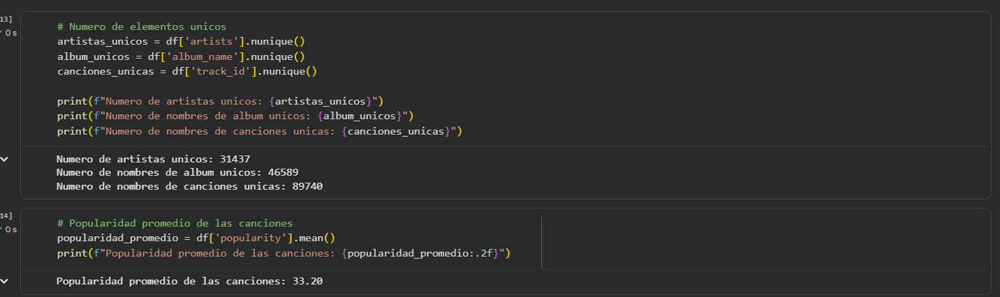

## 4. Descripción de las fuentes de datos

### 4.1 Origen del dataset

- **Nombre:** Spotify Tracks Dataset

- **Fuente:** AVA Duoc

- **Herramientas utilizadas:** Justificacion de las herramientas que se usaron.

  | Herramienta | Uso | Justificacion |
  |--|--|--|
  | Google Colab | Desarrollo del notebook | Herramienta hecha para poder crear notebooks de ciencia de datos con python y mediante el uso de la importacion de librerias, no es necesario descargar nada |
  | GitHub | Versionado y entrega | Para mantener registro del aporte de cada miembro, controlar las versiones del proyecto y poder reproducir el proyecto |
  | Google Drive | Almacenamiento del dataset | Permite montar el archivo en colab sin tener que buscarlo |

### 4.2 Estructura del dataset

- **N° de registros:** 114.000 filas

- **N° de columnas:** 20 (+ índice)

- **Géneros incluidos:** 114 géneros musicales

### 4.3 Diccionario de variables

| Variable         | Tipo        | Descripción                                    |
|------------------|-------------|------------------------------------------------|
| track_id         | string      | Identificador único de la canción en Spotify   |
| artists          | string      | Artista(s) que interpretan la canción          |
| album_name       | string      | Nombre del álbum                               |
| track_name       | string      | Nombre de la canción                           |
| popularity       | int (0-100) | Puntaje de popularidad asignado por Spotify    |
| duration_ms      | int         | Duración de la canción en milisegundos         |
| explicit         | bool        | Indica si la canción tiene contenido explícito |
| danceability     | float (0-1) | Qué tan bailable es la canción                 |
| energy           | float (0-1) | Intensidad y actividad percibida               |
| key              | int         | Tonalidad musical                              |
| loudness         | float (dB)  | Volumen general en decibeles                   |
| mode             | int (0/1)   | Modalidad (menor/mayor)                        |
| speechiness      | float (0-1) | Presencia de palabras habladas                 |
| acousticness     | float (0-1) | Confianza de que la pista sea acústica         |
| instrumentalness | float (0-1) | Predicción de ausencia de voz                  |
| liveness         | float (0-1) | Presencia de audiencia en vivo                 |
| valence          | float (0-1) | Positividad transmitida por la pista           |
| tempo            | float (BPM) | Tempo estimado                                 |
| time_signature   | int         | Compás estimado                                |
| track_genre      | string      | Género musical asignado                        |

## 5. Preparación y análisis exploratorio de los datos (EDA)

### 5.1 Calidad de los datos

Al momento del inicio del EDA nos percatamos que la cantidad de columnas era correcta y llegamos a la conclusión de que no sobra ninguna, por lo tanto no se modificaron.

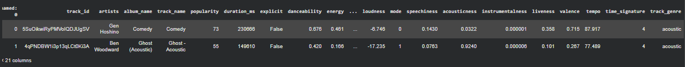

Posteriormente se realizó un búsqueda de valores nulos en el DF, mediante varias funciones se ubicaron 3 datos nulos en una sola fila. Primero se usó la función .info y luego la función .isnull para ubicar de manera más precisa los valores nulos.

Se descubrió que los 3 valores nulos estaban en una misma fila, al ser pocos valores nulos y en una sola fila se decidió borrar la fila ya que no afecta al DF.

Antes de borrar Después de borrar

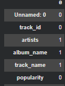 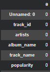

Luego de esto, se realizó la eliminación de la fila que contenía datos nulos y la eliminación de la columna duration_ms , ya que el mapa de correlación mostró una correlación de 1 con duration_min.

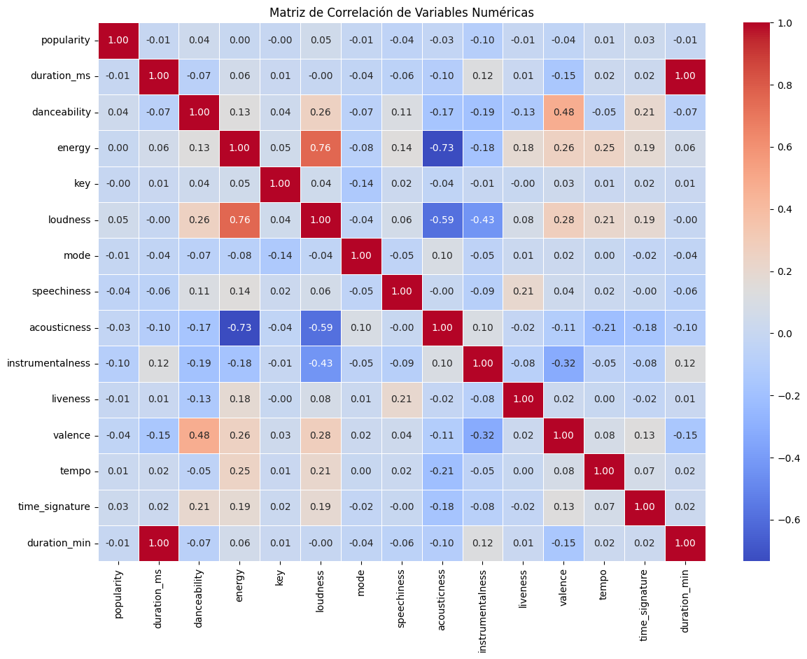

### 5.2 Análisis exploratorio

**EDA:**

Teniendo en cuenta el problema de la empresa, la cual requiere la predicción de la popularidad de las canciones se tomaron en cuenta las variables de Popularidad, los géneros, los artistas y la duración de las canciones.

De esta manera se reunió la cantidad de información suficiente para que la empresa pueda entender cómo se comporta la popularidad para el futuro.

Primero se tomó en cuenta la distribución de la popularidad de las canciones por duración de las mismas. De esta manera se puede visualizar cómo se comporta la popularidad de las canciones según su duración y en donde se concentra la mayoría del catálogo de la empresa.

**Gráfico para observar la distribución de la popularidad de las canciones por el tiempo de duración, para observar outliers.**

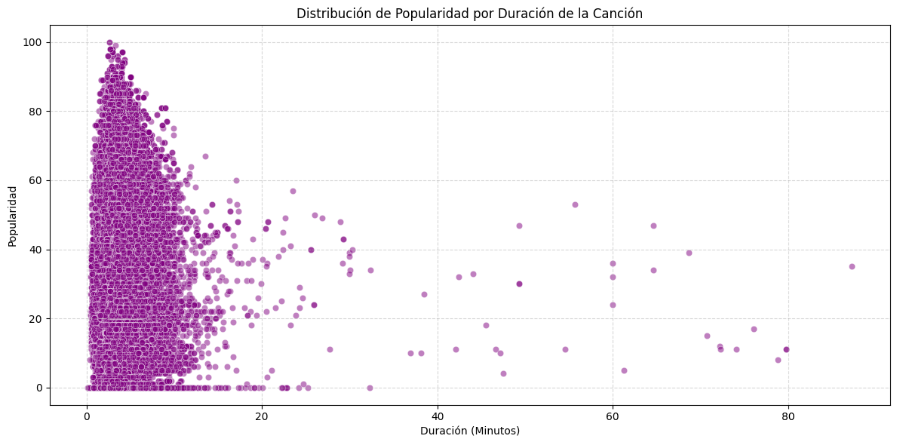

**Top 5 Artistas Mas Populares**

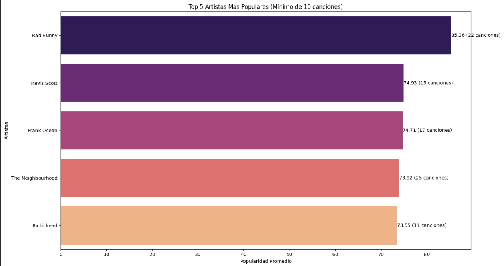

**Los 5 Géneros Más Populares**

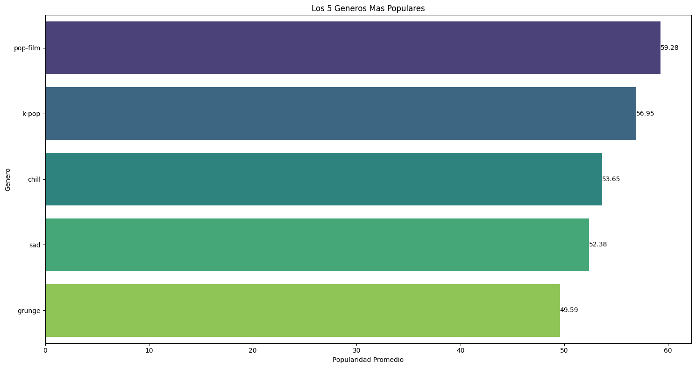

**Porcentaje de Canciones Explícitas vs No Explícitas (Popularidad > 60)**

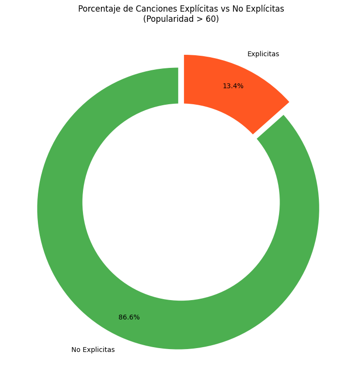

### 5.3 Variables menos relevantes para el modelo

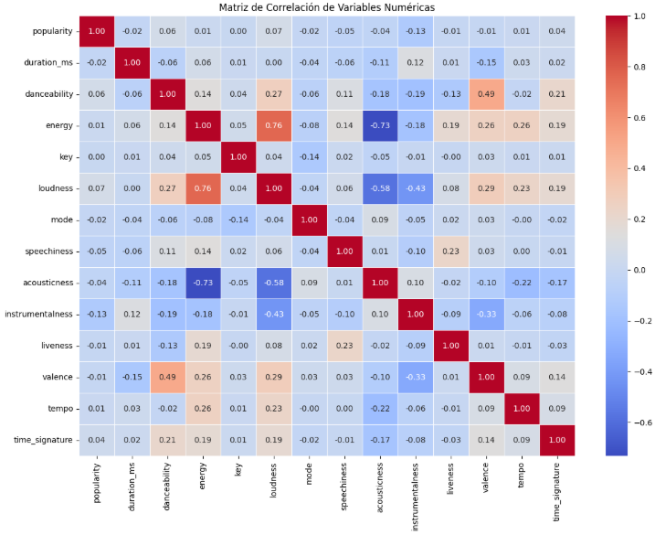

El análisis de correlación lineal muestra que las variables numéricas , es decir los atributos de audio, por sí solos no explican la popularidad de una canción.

### 5.4 Variables más relevantes para el modelo

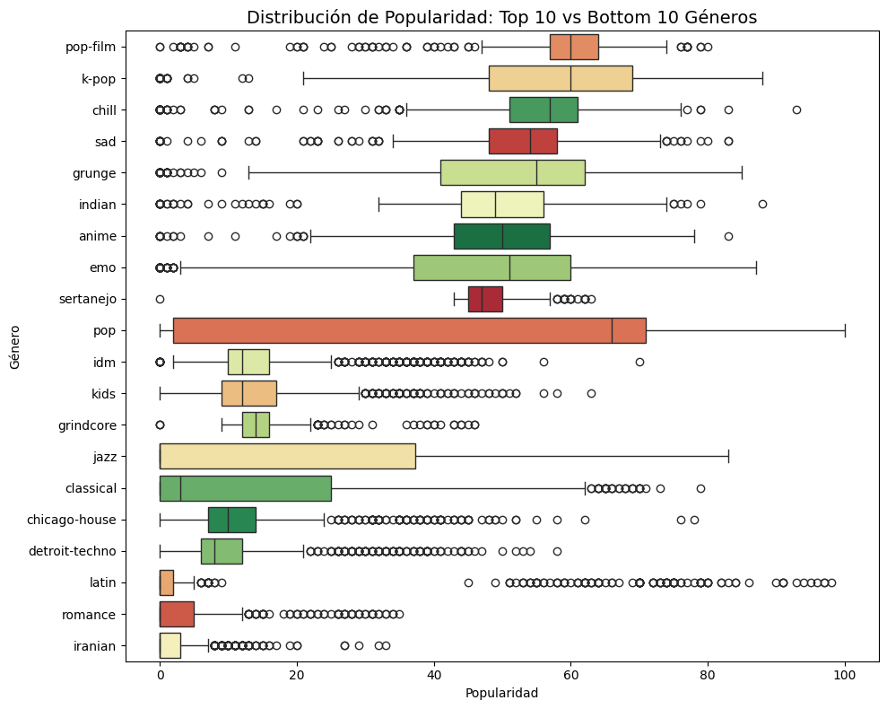

Se agruparon las canciones por género y se calculó la popularidad promedio de cada uno, para identificar los 10 géneros más populares y los 10 menos populares. El boxplot muestra no solo el promedio, sino la dispersión completa de cada género, permitiendo ver si la popularidad es consistente dentro del género o varía mucho entre sus canciones.

## 6. Evaluación de sesgos, ética y privacidad de los datos

### 6.1 Posibles sesgos

Sesgo temporal: Canciones más recientes pueden tener ventaja en el score de popularidad. Este sesgo presenta una limitacion, no se puede medir este sesgo ya que no hay fecha de lanzamiento en el datacet.

Sesgo de sobrerrepresentación: El df cuenta con 1000 canciones por cada género. Al ser una distribución artificial no refleja el consumo real de spotify.

### 6.2 Consideraciones éticas

Riesgo de retroalimentación algorítmica: Predecir y promover solo lo “popular” puede reducir la diversidad musical.

Falta de equidad con los artistas: Spotify cuenta tanto con artistas respaldados por enormes sellos discográficos , como con artistas independientes. Por lo que si predecimos la popularidad sin ese contexto no hay forma de que un artista independiente pueda competir con los números de un artista ya consolidado.

Usar la variable “Explicit” como predictor : Considerar esa variable en decidir qué contenido promocionar podría incentivar contenido explícito solo para ganar visibilidad, sin considerar el impacto en audiencias sensibles.

### 6.3 Privacidad de los datos

- El dataset no tiene datos de usuarios, la popularidad es una metrica agregada.
- Si contiene **nombres de artistas**, que son datos personales de personas reales. Su uso se limita a fines academicos y no se elaboran perfiles individuales.
- Marco normativo: **Ley 19.628** y **Ley 21.719** de proteccion de datos personales en Chile, y como referencia el **GDPR** (minimizacion y limitacion de la finalidad).
- Uso comercial: habria que revisar los **terminos de uso de la API de Spotify**. 

## 7. Conclusiones preliminares

El análisis muestra que la popularidad depende más del género musical y factores externos que de las características de audio.

**Hallazgo principal**

El género con mayor popularidad promedio (\`pop-film\`, 59.3) supera por más de 57 puntos al más bajo (\`iranian\`, 2.2). Géneros como \`pop\`, \`jazz\` y \`classical\` muestran cajas muy amplias, indicando alta variabilidad interna. Este dato es muy importante, porque no da a entender que el género por sí solo no garantiza popularidad, pero sigue siendo la variable considerando tanto categóricas como numéricas la que mejor separa canciones populares de no populares.
