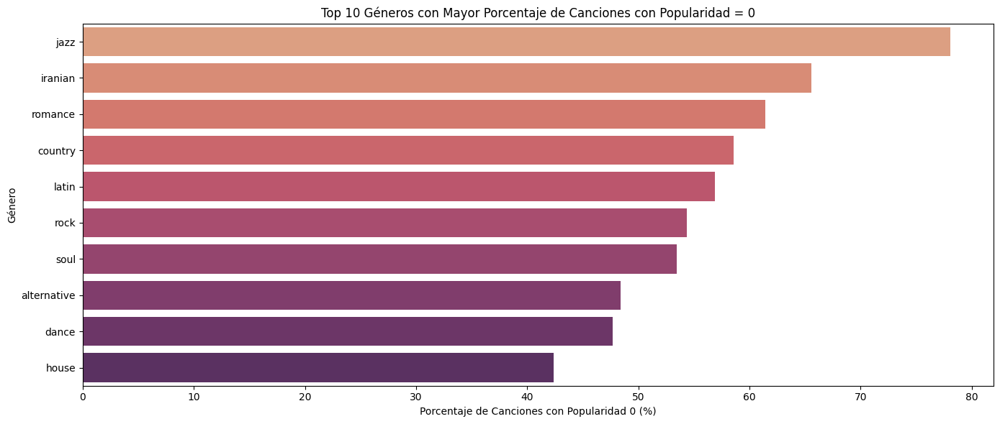
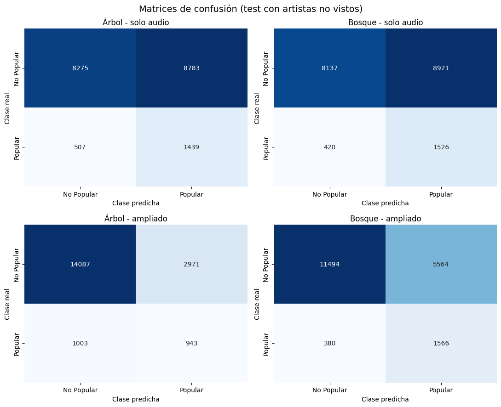
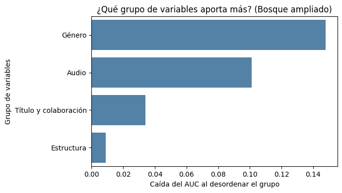
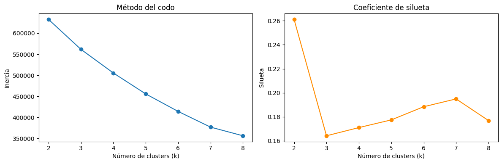
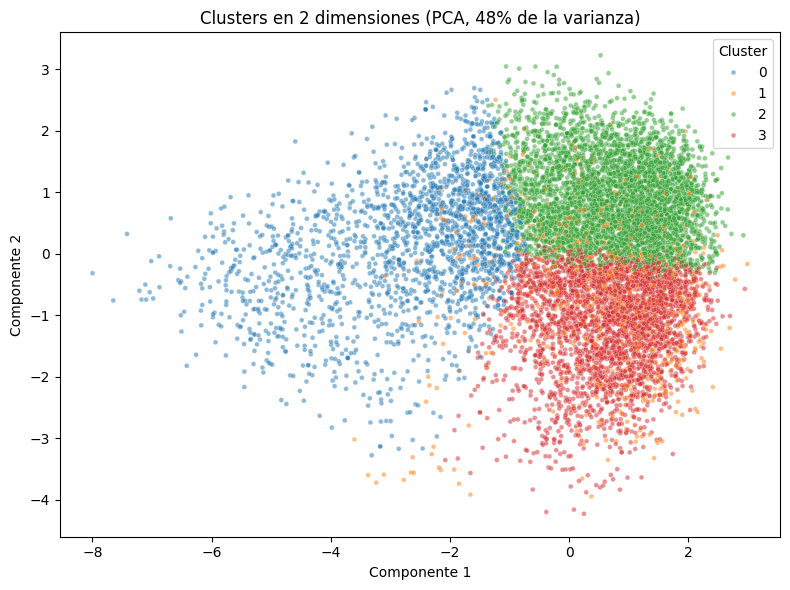

# Inteligencia Musical: Predicción de Popularidad de Canciones en Spotify

- **Asignatura:** MLY1101 – Machine Learning
- **Caso:** C – Inteligencia musical y predicción de popularidad de canciones (Spotify Tracks)
- **Integrantes del grupo:** Matías Cornejo, José Filidey, Gerald Santana
- **Fecha:** 14/09/2026 - Actualidad

## 1. Descripción del problema de negocio

La plataforma de Spotify necesita conocer qué canciones tienen mayor probabilidad de ser populares para optimizar decisiones de inversión en marketing y promoción de artistas. Por lo que requieren un análisis exploratorio de los datos, evaluación de sesgos y una serie de conclusiones preliminares para empezar a tomar decisiones sobre su catálogo.

### 1.1 Planteamiento del problema

¿Es posible clasificar o predecir el nivel de popularidad de una canción a partir de sus características de audio (danceability, energy, tempo, etc.) y metadatos (género, duración, explicit)?

Esta pregunta resume principalmente el objetivo general de los requerimientos del cliente. Puesto que a un nivel general predecir qué canciones priorizar o en que artistas invertir reduce el riesgo de pérdidas y aumenta la probabilidad de ganancias futuras.

## 2. Objetivos del proyecto

### 2.1 Objetivo general

Desarrollar un modelo de Machine Learning capaz de predecir la popularidad de una canción en Spotify a partir de sus atributos de audio y metadatos.

### 2.2 Objetivos específicos

Realizar un análisis exploratorio de datos (EDA) para identificar patrones y relaciones entre las variables de audio y la popularidad.

Evaluar la calidad de los datos e implementar un proceso de limpieza y preparación adecuado.

Identificar las variables más relevantes para la predicción de popularidad.

Evaluar posibles sesgos y consideraciones éticas asociadas al uso de estos datos.

Comparar modelos supervisados de clasificación (árbol de decisión y random forest) para predecir si una canción es popular.

Segmentar las canciones según su perfil de audio mediante un modelo no supervisado.

### 2.3 KPIs del proyecto

Definimos los siguientes indicadores y metas para evaluar los modelos. El enfoque final es de **clasificación binaria**: una canción se considera popular si su popularidad es ≥ 60.

**Las metas se fijaron antes de entrenar y no se modificaron al ver los resultados.**

| KPI | Definición | Meta | Resultado | Estado |
|---|---|---|---|---|
| Precisión | De las canciones que el modelo predice como populares (popularidad ≥ 60), porcentaje que realmente lo es | ≥ 40% | Bosque ampliado: 22,0% · Árbol ampliado: 24,1% | No cumple (umbral 0,5) |
| Tasa de falsos positivos | De las canciones con popularidad < 60, porcentaje que el modelo predice como populares | ≤ 15% | Bosque ampliado: 32,6% · Árbol ampliado: 17,4% | No cumple (umbral 0,5) |

### 2.4 Metodologia utilizada (CRISP-DM)

Para desarrollar este proyecto utilizamos la metodología CRISP-DM, que permite organizar las distintas etapas de un proyecto de Machine Learning, desde comprender el problema hasta evaluar los resultados.

| Etapa | Descripción | Estado |
|---|---|---|
| 1. Comprensión del negocio | Se identificó la necesidad de analizar y predecir la popularidad de las canciones para apoyar decisiones de promoción musical. | Realizado |
| 2. Comprensión de los datos | Se exploró el dataset de Spotify, revisando variables, valores nulos y relaciones con la popularidad. | Realizado |
| 3. Preparación de los datos | Se eliminaron nulos y duplicados y se revisaron valores atípicos y popularidad cero. | Realizado |
| 4. Modelado | Se entrenaron modelos supervisados (árbol de decisión y random forest) y un modelo no supervisado (K-Means). | Realizado |
| 5. Evaluación | Se evaluaron los modelos con precisión, recall, F1, AUC y tasa de falsos positivos frente a una línea base; los KPIs de precisión y falsos positivos no se alcanzaron con el umbral 0,5. | Realizado |
| 6. Despliegue | En una etapa posterior se podría usar el modelo como filtro auxiliar para priorizar canciones. | Pendiente |

El proyecto cubre desde la comprensión del problema hasta la evaluación de los modelos. El despliegue queda fuera del alcance de esta entrega.
 
## 3. Estadísticas descriptivas del dataset

Para conocer mejor la informacion disponible, realizamos un analisis inicial utilizando funciones de Python como `nunique()`, `mean()`, `info()` y `describe()`.

El dataset original contiene 114.000 registros y 21 columnas, incluyendo una columna de índice que no aporta información al análisis.

| Indicador | Resultado |
|---|---|
| Registros originales | 114.000 |
| Artistas únicos | 31.437 |
| Álbumes únicos | 46.589 |
| Nombres de canciones únicos | 73.608 |
| Canciones únicas por `track_id` después de eliminar nulos | 89.740 |
| Popularidad promedio del dataset original | 33,24 |
| Géneros musicales en el dataset original | 114 |
| Géneros musicales después de la limpieza | 113 |

Para contar correctamente las canciones únicas utilizamos `track_id`, ya que diferentes canciones pueden tener el mismo nombre. Además, identificamos que algunas canciones aparecen repetidas porque están clasificadas en más de un género musical.

Por lo cual este análisis nos permitió conocer la cantidad de información disponible y detectar registros repetidos. Por eso, fue necesario realizar una limpieza de datos antes de continuar con el análisis de popularidad.,

## 4. Descripción de las fuentes de datos

### 4.1 Origen del dataset

- **Nombre:** Spotify Tracks Dataset

- **Fuente:** AVA Duoc

- **Justificación de las herramientas utilizadas:**

Para desarrollar el proyecto utilizamos google colab, ya que nos permite trabajar con Python y sus librerias sin necesidad de instalar programas adicionales. Tambien utilizamos github para organizar los archivos, mantener un registro de los cambios y facilitar el trabajo en equipo. Por ultimo, google drive se considero como una alternativa para almacenar y compartir la base de datos.

Estas herramientas nos permiten mantener el proyecto organizado.

| Herramienta | Uso | Justificación |
|---|---|---|
| Google Colab | Desarrollo del notebook | Herramienta hecha para crear notebooks de ciencia de datos con Python y, mediante la importación de librerías, no es necesario descargar nada |
| GitHub | Versionado y entrega | Para mantener registro del aporte de cada miembro, controlar las versiones del proyecto y poder reproducir el proyecto |
| Google Drive | Almacenamiento del dataset | Permite montar el archivo en Colab sin tener que buscarlo y compartir los archivos entre los integrantes |
| Claude (Anthropic) | Asistencia en la escritura, revisión y explicación del código | Apoyo para escribir y depurar el código del notebook y entender los resultados |

### 4.2 Estructura del dataset

- **N° de registros:** 114.000 filas

- **N° de columnas:** 20 (+ índice)

- **Géneros incluidos:** 114 géneros musicales

### 4.3 Diccionario de variables

| Variable         | Tipo        | Descripción                                    |
|------------------|-------------|------------------------------------------------|
| track_id         | string      | Identificador único de la canción en Spotify   |
| artists          | string      | Artista(s) que interpretan la canción          |
| album_name       | string      | Nombre del álbum                               |
| track_name       | string      | Nombre de la canción                           |
| popularity       | int (0-100) | Puntaje de popularidad asignado por Spotify    |
| duration_ms      | int         | Duración de la canción en milisegundos         |
| explicit         | bool        | Indica si la canción tiene contenido explícito |
| danceability     | float (0-1) | Qué tan bailable es la canción                 |
| energy           | float (0-1) | Intensidad y actividad percibida               |
| key              | int         | Tonalidad musical                              |
| loudness         | float (dB)  | Volumen general en decibeles                   |
| mode             | int (0/1)   | Modalidad (menor/mayor)                        |
| speechiness      | float (0-1) | Presencia de palabras habladas                 |
| acousticness     | float (0-1) | Confianza de que la pista sea acústica         |
| instrumentalness | float (0-1) | Predicción de ausencia de voz                  |
| liveness         | float (0-1) | Presencia de audiencia en vivo                 |
| valence          | float (0-1) | Positividad transmitida por la pista           |
| tempo            | float (BPM) | Tempo estimado                                 |
| time_signature   | int         | Compás estimado                                |
| track_genre      | string      | Género musical asignado                        |

## 5. Preparación y análisis exploratorio de los datos (EDA)

### 5.1 Calidad de los datos

Al momento del inicio del EDA, utilizamos Python y la librería Pandas para revisar la informacion. Mediante funciones como info(), describe() e isnull() nos percatamos  que existen valores nulos, registros duplicados y posibles valores atípicos.

**1. Identificacion y eliminacion de valores nulos**

El dataset original contiene 114.000 registros y 21 columnas. Durante la revision encontramos tres valores nulos en las columnas `artists`, `album_name` y `track_name`, correspondientes a una misma fila.

Como se trataba de un solo registro, decidimos eliminarlo, ya que su eliminacion no afecta al conjunto de datos.

Despues de este procedimiento quedaron 113.999 registros.

**2. Identificación y tratamiento de duplicados**

Posteriormente revisamos los registros duplicados utilizando la columna `track_id`, que permite identificar cada canción.

Encontramos 24.259 registros con identificadores repetidos. Esto ocurre porque una misma canción puede aparecer clasificada en diferentes géneros musicales.

Para evitar que estas repeticiones afecten los análisis y los resultados de un futuro modelo, eliminamos los duplicados utilizando `drop_duplicates()`, conservando la primera aparición de cada canción.

Después de este proceso quedaron 89.740 canciones únicas.

Esta decisión también tiene una limitación, ya que algunas canciones pertenecen a más de un género, pero al eliminar los duplicados se conserva solamente el primer género registrado.

**3. Análisis de canciones con popularidad cero**

Durante el análisis identificamos canciones con un valor de popularidad igual a cero.

Después de la limpieza encontramos 9.447 canciones con popularidad cero (10,53%). Estos valores se concentran de manera diferente según el genero, por ejemplo en el análisis aparecen proporciones altas en jazz, iranian y romance. Esto no demuestra que sean errores, sino que podrían reflejar características de los datos o de como se asigna la popularidad.

Por este motivo decidimos conservar estos registros y tener en cuenta su distribución por género al evaluar los modelos.

**4. Revisión de valores atípicos en la duración**

También analizamos las canciones con duraciones muy cortas o demasiado largas.

Identificamos 790 canciones con duración inferior a un minuto y 550 canciones con duración superior a diez minutos.

Al revisar estos casos, observamos que algunas duraciones pueden ser normales dependiendo del género musical, como canciones infantiles cortas o mezclas de música electrónica más extensas.

Por esta razón decidimos conservar estos registros, ya que eliminarlos podría afectar la representación de ciertos géneros.

**5. Resumen de la preparación de datos**

| Etapa | Registros |
|---|---:|
| Dataset original | 114.000 |
| Después de eliminar valores nulos | 113.999 |
| Después de eliminar duplicados por `track_id` | 89.740 |
| Después de revisar popularidad cero | 89.740 |
| Después de revisar valores atípicos | 89.740 |

La preparacion de datos permitio identificar y corregir problemas que podian afectar el analisis. Finalmente, obtuvimos un conjunto de 89.740 canciones unicas, conservando los valores de popularidad cero y las duraciones atipicas debido a que no encontramos evidencia suficiente para eliminarlos.

### 5.2 Análisis exploratorio de datos (EDA)

En esta etapa analizamos la relación entre la popularidad de las canciones y algunas de sus caracteristicas, como el artista, género musical, contenido explicito y duracion.

El objetivo es identificar patrones que puedan ayudarnos a seleccionar las variables más relevantes para un futuro modelo de Machine Learning.

**1. Relación entre duracion y popularidad**

**Objetivo:** Analizar si la duracion de una cancion tiene relacion con su popularidad e identificar posibles valores atipicos.

**Hallazgo:** La duracion mediana de las canciones es aproximadamente 3,55 minutos. También encontramos canciones con duraciones extremas, incluyendo algunas que superan los 10 minutos.

**Implicancia:** La duracion por si sola no parece explicar de manera importante la popularidad. Además, decidimos conservar las duraciones atipicas, ya que pueden ser normales en determinados generos musicales.

**2. Top 5 artistas mas populares**

**Objetivo:** Identificar los artistas con mayor popularidad promedio, considerando un minimo de 10 canciones para evitar resultados poco representativos.

**Hallazgo:** Bad Bunny destaca entre los artistas con mayor popularidad promedio. Para realizar esta comparación se consideraron solamente artistas con al menos 10 canciones.

**Implicancia:** La popularidad puede variar bastante entre artistas. Por eso, es importante considerar que algunos artistas ya tienen una trayectoria y reconocimiento que pueden influir en sus resultados.

**3. Los 5 generos mas populares**

**Objetivo:** Identificar que generos musicales presentan los mayores niveles de popularidad promedio.

**Hallazgo:** Los generos con mayor popularidad promedio en el analisis actualizado son k-pop, pop-film, metal, chill y latino.

**Implicancia:** El género musical presenta diferencias importantes en los niveles de popularidad, por lo que puede ser una variable relevante para desarrollar un modelo predictivo.

**4. Canciones explicitas y no explicitas**

**Objetivo:** Analizar si existe una relación entre el contenido explicito de una cancion y su popularidad.

**Hallazgo:** Entre las canciones con popularidad superior a 60, aproximadamente el 14,4% contiene contenido explicito, mientras que en el catalogo analizado este porcentaje es cercano al 8,6%.

**Implicancia:** El contenido explicito podria ser una variable util para el analisis, pero esta relacion no demuestra que una cancion sea mas popular por ser explicita. Tambien debemos considerar los posibles riesgos eticos de utilizar esta caracteristica para recomendar o promocionar musica.

**5. Investigación de Canciones con Popularidad Cero por Género**
Analizamos si la concentración de canciones con popularidad igual a 0 responde a géneros musicales específicos o si está distribuida de manera uniforme en el dataset.

Las canciones con popularidad cero no están distribuidas de manera uniforme. De hecho, se concentran fuertemente en géneros particulares.

No  representan "datos faltante" (como un valor nulo en la base de datos), sino más bien pistas inactivas en la plataforma dentro de esos nichos. Una posible hipotesis es que sean sonidos ambientales para estudiar y dormir; Pero el dataset no permite validarlo.

**Objetivo:** determinar si los ceros están repartidos al azar o concentrados.

**Hallazgo:** los ceros son ~10,5% del dataset y se concentran: jazz 78%, iranian 66%, romance 61%, country 59%, latin 57%.

**Implicancia:** no son datos faltantes sino un patrón por género; eliminarlos sesgaría el modelo contra esos géneros.

**Decición en torno a los valores 0:** Se ha decidido mantenerlos, ya que reflejan canciones reales. El modelo debe aprender que ciertos géneros tienden a 0.

### 5.3 Relacion lineal entre variables numericas y popularidad

Para identificar que caracteristicas tienen relacion con la popularidad, realizamos un analisis de correlacion entre las variables numericas del dataset.

**Objetivo:** Identificar si caracteristicas como la energia, duracion, tempo y otras variables de audio presentan una relacion lineal con la popularidad de las canciones.

**Hallazgo:** Los resultados muestran que las caracteristicas de audio tienen correlaciones lineales debiles con la popularidad. La variable `instrumentalness` presenta una correlacion aproximada de -0,13, mientras que la duracion tiene una correlacion cercana a -0,02.

Tambien encontramos relaciones entre algunas caracteristicas de audio, como `energy` y `loudness`, con una correlacion aproximada de 0,76.

**Implicancia:** Estos resultados indican que las caracteristicas de audio por si solas no presentan una relacion lineal fuerte con la popularidad. Sin embargo, esto no significa que debamos descartarlas, ya que podrian aportar informacion al combinarlas con otras variables en un modelo de Machine Learning.

### 5.4 Variables mas relevantes para el modelo

Despues de analizar las caracteristicas numericas, realizamos una comparacion de la popularidad segun el genero musical.

**Objetivo:** Identificar si existen diferencias importantes en la popularidad de las canciones dependiendo del genero al que pertenecen.

**Hallazgo:** El grafico compara los 10 generos con mayor popularidad promedio y los 10 con menor popularidad. Se observan diferencias importantes entre ambos grupos, aunque tambien existe variacion dentro de cada genero.

Esto significa que algunas canciones de generos con baja popularidad promedio pueden alcanzar valores altos, mientras que no todas las canciones de los generos mas populares tienen buenos resultados.

**Implicancia:** El genero musical parece ser una variable relevante para diferenciar los niveles de popularidad de las canciones. Por eso, consideramos importante incluirlo en el futuro modelo predictivo.

**Conclusión:** El analisis exploratorio muestra que el género musical puede influir en las diferencias de popularidad entre canciones. Sin embargo, pertenecer a un genero popular no asegura que una cancion tenga una popularidad alta. Por esta razon, consideramos importante utilizar el género junto con otras características musicales para desarrollar y evaluar los modelos de Machine Learning.

## 6. Modelado supervisado

### 6.1 Planteamiento

Se plantea un problema de **clasificación binaria**: predecir si una canción es popular (popularidad ≥ 60) o no. Con este criterio, aproximadamente el 10% de las canciones son populares. Se eligió ≥ 60 porque representa canciones realmente exitosas, que es lo que interesa para decidir inversión en promoción, y porque coincide con la definición usada en los KPIs.

Se construyeron 134 variables en 4 grupos: **audio** (11), **estructura** (3: duración, tonalidad y compás), **título y colaboración** (7: número de artistas, indicadores de remix, live, remaster y feat, largo del título y si es single) y **género** (113 columnas, una por género).

### 6.2 División de los datos y balanceo

- **División:** 80% entrenamiento y 20% prueba (19.004 canciones), agrupando por **artista principal** para que ningún artista aparezca en ambos conjuntos. Además, se eliminaron del entrenamiento 12.630 canciones donde cualquier artista (incluidos invitados) aparece en el conjunto de prueba, para evitar fuga de información.
- **Balanceo:** solo en entrenamiento y por submuestreo aleatorio de la clase mayoritaria (no populares), sin repetir filas ni crear datos sintéticos. Quedaron 5.555 canciones por clase (11.110 en total), lo que descarta cerca del 81% del entrenamiento.
- **Prueba:** se mantuvo intacta, con ~90% de canciones no populares y ~10% populares.
- **Hiperparámetros:** la profundidad máxima de cada modelo se eligió con validación cruzada agrupada por artista, usando solo el entrenamiento. La grilla se limitó para mantener el tiempo de ejecución en torno a 3 minutos; en los modelos ampliados el mejor valor quedó en el extremo (árbol: 16, bosque: 20), por lo que una mayor profundidad podría mejorar levemente el resultado.

### 6.3 Resultados

Se compararon cinco modelos en el conjunto de prueba, con umbral de decisión 0,5:

| Modelo | Accuracy | Precisión | Recall | F1 | AUC | Tasa FP |
|---|---|---|---|---|---|---|
| Línea base (siempre "no popular") | 0,898 | 0,000 | 0,000 | 0,000 | 0,500 | 0,000 |
| Árbol, solo audio | 0,511 | 0,141 | 0,739 | 0,237 | 0,631 | 0,515 |
| Bosque, solo audio | 0,508 | 0,146 | 0,784 | 0,246 | 0,685 | 0,523 |
| Árbol, ampliado | 0,791 | 0,241 | 0,485 | 0,322 | 0,691 | 0,174 |
| **Bosque, ampliado** | 0,687 | 0,220 | **0,805** | **0,345** | **0,817** | 0,326 |

- La **accuracy no es una referencia útil**: la línea base logra 0,898 solo porque ~90% de las canciones no son populares.
- El **bosque ampliado** obtuvo el mejor AUC, F1 y recall, y es el modelo preferido. El árbol ampliado logró mayor precisión y menos falsos positivos con ese umbral, además de ser interpretable.
- La **precisión es baja** en todos los modelos (0,14–0,24), pero supera la tasa base de canciones populares (~10%). Subir el umbral aumentaría la precisión a costa de encontrar menos canciones populares.
- **Variables que más aportan** (caída del AUC al desordenar cada grupo en el bosque ampliado): género 0,148, audio 0,101, título y colaboración 0,034 y estructura 0,009. Esto indica aporte a la predicción, no causalidad.

**Conclusión:** los modelos tienen un desempeño moderado y no alcanzan las metas de precisión (40%) ni de falsos positivos (15%) con el umbral 0,5. Sirven como filtro auxiliar para priorizar canciones, no como único criterio de inversión.

## 7. Modelo no supervisado: segmentación de canciones

Se aplicó **K-Means** sobre 9 variables continuas de audio estandarizadas, sin usar popularidad ni género, para ver si existen "tipos" de canciones. Se eligió **k = 4**: la silueta más alta es la de k = 2 (≈ 0,26), pero solo separaría canciones calmas de intensas; con k = 4 la silueta es ≈ 0,17 y los grupos son interpretables. Una silueta baja indica que los grupos se solapan.

| Grupo | Perfil de audio | Géneros dominantes | Canciones | Popularidad ≥ 60 | Popularidad 0 |
|---|---|---|---|---|---|
| Calmas y acústicas | Energía baja (0,26), muy acústicas (0,78) | ambient, new-age, sleep, classical | 18.648 | 8,2% | 14,5% |
| En vivo y habladas | Mucha presencia de público (0,74) y de habla (0,21) | comedy, pagode, sertanejo, samba | 7.001 | 5,3% | 5,4% |
| Bailables y alegres | Danceability (0,69) y valence (0,67) altas | salsa, kids, dancehall, forro | 36.646 | 13,8% | 12,0% |
| Intensas y rápidas | Energía alta (0,80), tempo 136 BPM, poco acústicas | black-metal, grindcore, death-metal, drum-and-bass | 27.445 | 10,3% | 7,3% |

**Conclusión:** el audio separa tipos de canciones coherentes con familias de géneros, pero se relaciona solo débilmente con la popularidad (la proporción de canciones ≥ 60 va de 5,3% a 13,8%). La segmentación sirve para describir el catálogo, no para predecir éxito.

## 8. Evaluacion de sesgos, etica y privacidad de los datos

Durante el desarrollo del proyecto identificamos algunos posibles sesgos y riesgos eticos que pueden afectar los resultados de un futuro modelo de Machine Learning.

Es importante considerar estos aspectos, ya que el objetivo no es solamente predecir la popularidad, sino tambien evitar decisiones que puedan perjudicar a ciertos artistas o generos musicales.

### 8.1 Posibles sesgos

**Sesgo temporal:**

Las canciones mas recientes podrian tener ventajas o desventajas en su nivel de popularidad. Sin embargo, el dataset no contiene fechas de lanzamiento, por lo que no podemos comprobar directamente este sesgo.

Por esta razon, lo consideramos una limitacion del conjunto de datos y no un resultado confirmado.

**Sesgo de representacion de generos:**

El dataset original contiene 1.000 registros por cada uno de los 114 generos musicales. Esta distribucion no necesariamente representa la cantidad real de canciones o reproducciones que tiene cada genero en Spotify.

Ademas, al eliminar las canciones duplicadas por track_id, el numero de generos paso de 114 a 113: el genero songwriter dejo de aparecer. Los generos restantes quedaron con cantidades diferentes, entre 74 y 1.000 canciones por genero.

Esto podria afectar los resultados del futuro modelo, ya que algunos generos podrian tener mayor representacion que otros.

**Desbalance de clases:**
Solo ~10% de las canciones son populares (≥ 60). Para entrenar, se balanceó por submuestreo, descartando cerca del 81% del entrenamiento. Esto reduce la información disponible y hace que las probabilidades del modelo no reflejen la proporción real, por lo que el umbral de decisión debe elegirse con cuidado.

### 8.2 Consideraciones éticas

**Riesgo de retroalimentación algorítmica:**

Si Spotify utiliza un modelo para promocionar solamente las canciones que tienen mayor popularidad, podria generar un ciclo donde los artistas populares reciben cada vez mas visibilidad, mientras que otros tienen menos oportunidades.

**Desigualdad entre artistas:**

Los artistas reconocidos generalmente cuentan con mas recursos, publicidad y seguidores que los artistas independientes.

Si el modelo utiliza solamente la popularidad histórica, podría favorecer a los artistas consolidados y dificultar que nuevos artistas tengan oportunidades de promoción.

**Uso de la variable explicit:**

Durante el análisis encontramos diferencias en la proporción de canciones explicitas entre el catalogo general y las canciones con mayor popularidad.

Sin embargo, esto no significa que el contenido explicito provoque mayor popularidad. Utilizar esta variable para decidir que canciones promocionar podria generar decisiones poco equilibradas.

**Riesgo de que el modelo desfavorezca géneros poco populares:**
Como el género es el grupo de variables que más aporta a la predicción, usar el modelo para decidir qué promocionar podría perjudicar sistemáticamente a géneros o artistas independientes con baja popularidad histórica. Por eso, las predicciones deben usarse como apoyo y no como criterio único.

### 8.3 Privacidad y protección de los datos

El dataset utilizado no contiene información personal de los usuarios que escuchan musica, como nombres, correos electrónicos o historial individual de reproducciones.

La popularidad corresponde a un indicador general de cada canción.

Sin embargo, el dataset contiene nombres de artistas, por lo que es importante utilizar esta información de manera responsable y solamente para los objetivos académicos del proyecto.

Para considerar la protección de los datos, tomamos como referencia:

- **Ley 19.628:** normativa chilena relacionada con la protección de datos personales.
- **Ley 21.719:** nueva normativa chilena que modifica el marco de protección de datos personales.
- **GDPR:** reglamento europeo que establece principios relacionados con el uso responsable y la protección de datos.

En caso de utilizar esta información con fines comerciales, también seria necesario revisar los términos y condiciones de uso de los datos de Spotify.

Identificar estos posibles sesgos y riesgos nos permite comprender que los resultados del modelo podrían afectar de manera diferente a los artistas y géneros musicales. Por eso, es importante evaluar estos aspectos antes de utilizar las predicciones para tomar decisiones comerciales.

## 9. Conclusiones del proyecto

Durante el desarrollo de este proyecto realizamos un análisis exploratorio del dataset de Spotify para identificar que características pueden estar relacionadas con la popularidad de las canciones.

Los resultados nos permitieron comprender mejor el comportamiento de los datos, identificar problemas de calidad y reconocer variables que podrían ser importantes para un futuro modelo de Machine Learning.

### 9.1 Principales hallazgos

**1. Importancia del genero musical**

El analisis mostro que existen diferencias importantes en la popularidad promedio de los generos musicales. Esto nos permite considerar el genero como una variable relevante para el futuro modelo predictivo.

Sin embargo, pertenecer a un genero popular no garantiza que todas sus canciones tengan una popularidad alta.

**2. Caracteristicas de audio**

Las variables de audio, como energia, tempo, duracion y otras caracteristicas, presentaron correlaciones lineales debiles con la popularidad.

Esto indica que ninguna de estas variables, por si sola, permite explicar completamente la popularidad de una cancion.

**3. Calidad y preparación de los datos**

Durante la preparación identificamos valores nulos, canciones duplicadas y valores atípicos.

Después de realizar la limpieza, el dataset quedo con 89.740 canciones únicas, lo que permite trabajar con información mas organizada para las siguientes etapas.

**4. Sesgos y aspectos éticos**

Identificamos posibles sesgos relacionados con la representación de géneros, la popularidad de artistas consolidados y la falta de información temporal.

También consideramos aspectos de privacidad y los posibles efectos de utilizar las predicciones para decidir que canciones promocionar.

**5. Desempeño de los modelos supervisados**

El mejor modelo fue el bosque ampliado (AUC 0,82, recall 0,81). Su precisión (0,22 con umbral 0,5) supera la tasa base de canciones populares (~10%), pero no alcanza la meta de 40%. El género fue el grupo de variables que más aportó a la predicción, seguido por las variables de audio.

**6. Segmentación de canciones**

El audio permite formar cuatro tipos de canciones coherentes con familias de géneros, pero esos grupos se relacionan débilmente con la popularidad.

### 9.2 Cumplimiento de los objetivos específicos

| Objetivo específico | Resultado obtenido | Cumplimiento |
|---|---|---|
| Realizar un análisis exploratorio para identificar patrones | Se identificaron diferencias de popularidad entre géneros y relaciones débiles con las variables de audio. | Cumplido |
| Evaluar la calidad y preparar los datos | Se eliminaron valores nulos y duplicados, además de revisar los valores atípicos y la popularidad cero. | Cumplido |
| Identificar variables relevantes para la predicción | El género fue el grupo que más aportó a la predicción (caída del AUC de 0,148), seguido por el audio (0,101); las variables de audio solas tienen correlaciones lineales débiles. | Cumplido |
| Evaluar sesgos y consideraciones éticas | Se identificaron posibles sesgos, riesgos éticos y aspectos relacionados con la privacidad. | Cumplido |
| Comparar modelos supervisados de clasificación | Se entrenaron cinco modelos frente a una línea base; el bosque ampliado fue el mejor (AUC 0,82). | Cumplido; los KPIs de precisión y falsos positivos no se alcanzaron |
| Segmentar canciones con un modelo no supervisado | K-Means con 4 grupos interpretables por perfil de audio y género. | Cumplido |

### 9.3 Conclusión general

Como conclusión, el proyecto permitió comprender los factores asociados a la popularidad de las canciones y evaluar si es posible predecirla. Los modelos supervisados muestran un desempeño moderado: el bosque ampliado ordena razonablemente las canciones (AUC 0,82), pero con el umbral 0,5 su precisión (22,0%) y su tasa de falsos positivos (32,6%) no cumplen las metas de ≥ 40% y ≤ 15%. Aun así, supera la proporción de canciones populares del catálogo (~10%). El género musical es el grupo de variables que más aporta a la predicción, lo que no implica que cause la popularidad. El análisis no supervisado muestra que el audio forma tipos de canciones coherentes, pero débilmente relacionados con la popularidad.

En conjunto, el modelo sirve como filtro auxiliar para priorizar canciones, no como único criterio de inversión.

